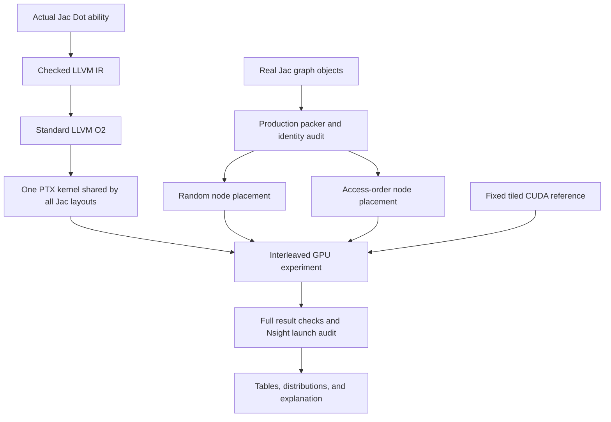

# Jac GPU layout benchmark: how it works

Start with [SPEC.md](SPEC.md) for the requirements and acceptance criteria.
This guide explains the experiment, the code, and how to read its eventual results.
The specification's [requirement mapping](SPEC.md#requirement-traceability) links
each acceptance condition to its source and implementation.

The runner is [benchmark.jac](benchmark.jac), the evidence validator and report
generator are [results.jac](results.jac), and the native Jac test blocks are in
[tests.jac](tests.jac). These contain the actual harness logic. They reuse the
branch's existing Python graph-packing/compiler/CUDA helpers and its independent
CUDA reference kernel. The measured `Dot` workload itself is already Jac.

Only harness checks and synthetic CPU tests are used during development. No
graph preparation, GPU workload compilation, GPU validation, profiling, or
benchmark measurements are run. Report generation and PDF rendering have been
checked with synthetic inputs; CUDA integration remains unverified.

## The question in one example

Imagine several people following directions through a warehouse. The directions
stay the same, but moving frequently accessed items closer together may reduce
the cost of fetching them. Here the people are GPU threads, the directions are
Jac cursor traversals, and the warehouse is GPU memory.

We keep the Jac computation fixed and change the physical arrangement of its
nodes. The experiment asks whether the arrangement predicted from cursor access
order improves execution time. The compiler and packer work together: the
compiler supplies the traversal semantics, and the packer assigns physical IDs.
The benchmark evaluates this specific strategy; it does not demonstrate a
general optimizer that chooses the best layout for every Jac program.

## Why matrix multiplication is a graph workload here

For an M-by-K matrix A and a K-by-N matrix B, output C has M*N entries:

```text
C[i,j] = sum(A[i,q] * B[q,j] for q = 0 ... K-1)
```

The real Jac example represents input scalars as graph nodes. `RowNext` edges
connect A values along rows; `ColumnNext` edges connect B values along columns.
One `Dot` walker owns each output. Its `a` cursor follows an A row, its `b` cursor
follows a B column, and each step adds the product to its private accumulator.
Walkers share input nodes. There are K*(M+N) unique input nodes and M*N walkers.

At N=256, neighboring lanes cover neighboring columns of one output row. Their
`a` cursors can read the same A node, while their `b` cursors read distinct B
nodes. Placing those B nodes together could reduce the number of memory segments
their logical accesses span. Actual GPU transactions still depend on compiled
instructions, cache state, and other hardware behavior.

Five shapes cover tiny, rectangular, and larger cases through 256 cubed. Every
kernel computes all outputs, and the input values keep int64 arithmetic within
range. This is a scalar integer graph experiment, not a floating-point tensor-core
or cuBLAS throughput benchmark.

Source: [the Jac program](../../../jac/examples/gpu/named_cursors.jac).

## The three primary columns

| Column | What changes | Why it exists |
| --- | --- | --- |
| Jac before | Physical node IDs are shuffled with seed 928 | Establish a fixed random-layout baseline |
| Jac after | Complete cursor-a BFS is followed by complete cursor-b BFS, preserving first occurrence | Test access-order placement |
| CUDA reference | Dense arrays and a fixed 16-by-16 tiled int64 CUDA algorithm | Show the remaining whole-implementation performance gap |

Both Jac arms execute the **same checked LLVM O2 PTX and loaded function**.
Node values, logical edges, per-row traversal order, starts, states, thread
assignments, bounds, and launch geometry stay fixed. Reordering consistently
updates the structure-of-arrays field columns, CSR adjacency references, heads,
and initialized queue entries. CSR means compressed sparse row: offsets identify
each adjacency list and targets store its neighboring node IDs.

Random seeds 929 and 930 repeat the layout experiment to check whether the
direction depends on one shuffle. They remain supporting results; the primary
baseline stays seed 928.



## What happens when execution is requested

The [Jac entry point](benchmark.jac) performs these stages in order and records the
exact commands and logs. Any required-stage failure stops the pipeline.

1. **Prepare production inputs.** Build fresh real Jac graphs through the existing
   builder and packer. Save typed arrays, the independent arithmetic oracle, and
   preparation costs. Serial Jac checks representative outputs; it is not timed
   as a full CPU baseline.
2. **Audit layouts.** Reconstruct the predicted order, generate the supporting
   permutations, and verify every lane visits the same logical identities.
   Save arrays and hashes so a later reader can inspect exactly what ran.
3. **Compile.** Emit baseline and checked O2 PTX from the same production LLVM
   module. Compile the reference with nvcc O3. This fresh path does not require
   equality with a saved October 2026 binary.
4. **Validate error behavior.** The existing 13 fixtures exercise valid execution,
   overflow, invalid indices/CSR, queue capacity, visit limits, and empty/type
   cases. Both newly emitted Jac kernels must match the production host JIT.
5. **Measure and audit the primary trace.** Randomize arm order in each round,
   warm up, then measure 15 rounds with 16 sequential graph nodes per replay.
   Poison outputs/statuses before replay and verify every result afterward.
   Nsight Systems traces each node; the auditor matches all 7,225 launches,
   including 6,000 measured launches, to their expected identity and geometry.
6. **Collect supporting evidence.** Run separate ordinary event timing, derive a
   logical address-segment model, and attempt a separate hardware-counter probe.
   Missing Nsight Compute or denied counter access is recorded without changing
   driver settings. Other probe failures stop the suite.
7. **Build the report.** Recheck evidence hashes, full workload coverage, launch
   geometry, repetitions, statuses, and unique round/node identities. Recompute
   timing summaries from raw samples and reject discrepancies. Generate CSV,
   JSON, Markdown and PDF from the new measurements, including any regressions.
   Reports identify the run by its start time, directory, and primary trace hash.

The runner retains the existing CUDA driver helper. Each case checks its planned
allocations against currently free VRAM and releases its buffers before the next
case. It targets the existing compute_86/sm_86 reference configuration.

## Why there are two kinds of time

**Actual kernel time** is the GPU kernel's end minus start in the Nsight trace.
That is the primary metric. Allocation, copying inputs, compiling, graph capture,
poisoning, and checking results occur outside it.

**CUDA-event replay time** covers a CUDA graph replay divided by its 16 kernel
nodes. It can include GPU scheduling gaps. The suite saves a separate ordinary
run with this metric rather than mixing it into the primary table.

Graph construction and packing costs are retained from preparation. Per-arm
allocation/upload, capture/prime, and replay copyback/validation diagnostics are
also saved. The combined diagnostic intervals have the names shown in the data;
they are not measurements of pure transfer time. They do not add up to a validated
public API latency or establish a CPU-versus-GPU speedup. A later application
benchmark must time the complete public-runtime call and a matched CPU baseline.

The 16 nodes within one replay are correlated samples. The raw data retain round
identity so future analysis can reason about variability without treating every
node as an independent experiment. Device snapshots show competing GPU processes;
the report does not assume the GPU was exclusive.

The report validator checks that every expected node belongs to exactly one
round and that saved medians, percentiles, extrema, and round means agree with
the samples. This catches damaged or mismatched evidence before it becomes a
speedup claim. It does not replace actually running the workload on the GPU.

## Reading the results

For illustration only, suppose the three medians were 100, 50, and 10 microseconds:

- Layout speedup is `100 / 50 = 2`: the new placement halves kernel time.
- Residual gap is `50 / 10 = 5`: the Jac graph implementation takes five times
  the CUDA reference's time on that workload.

These are teaching numbers, not measured results. A before/after ratio below 1
is a regression; the report preserves it. A ratio close to 1 needs examination of
the distributions and paired rounds before calling it meaningful. There is no
minimum speedup required for a valid experiment.

The residual gap includes algorithm and representation differences: Jac still
traverses graph structures and retains checks, while the tiled CUDA reference
uses dense indexing and shared-memory reuse. It cannot all be called compiler
overhead. Likewise, fewer modeled address segments do not establish fewer actual
cache misses without hardware evidence.

## Commands

Run these commands from the `jaseci` repository root. On any machine, inspect the
future steps without creating result directories or touching CUDA. The Jac CLI
may compile/cache the harness itself:

```bash
jac run --backend python scripts/gpu_walker/layout_bench/benchmark.jac plan --output /tmp/jac-layout-run-001
```

CPU-only native Jac tests use standard-library mocks and synthetic records.
One test renders a real synthetic PDF when Matplotlib is installed; it skips
that check when Matplotlib is absent:

```bash
JAC_TEST_JOBS=0 jac test scripts/gpu_walker/layout_bench/tests.jac -v
```

**For a future explicitly requested GPU run:** use little-endian 64-bit Linux,
an NVIDIA GPU compatible with compute_86, a compatible driver, and the checkout's
working Jac/LLVM Python environment. It must include NumPy and Matplotlib, the
bundled LLVM NVPTX support, nvcc, ptxas, Nsight Systems, and `nvidia-smi`. CUDA 12.9
is the toolchain used by the original study. Nsight Compute is attempted when
available. Keep Python assertions enabled; `-O` and `PYTHONOPTIMIZE` are rejected.

```bash
# This command EXECUTES compilation, GPU validation and performance measurements.
# It was not executed during implementation.
jac run --backend python scripts/gpu_walker/layout_bench/benchmark.jac run --output /tmp/jac-layout-run-001
```

`--nvcc`, `--ptxas`, `--nsys`, and `--ncu` accept executable paths when the tools
are not on PATH. The Jac harness runs on the Python backend and reuses that
interpreter for the legacy helpers and the Jac reporting subprocess. Execution
requires the loaded `jaclang` package to come from this checkout, so the recorded
source hashes describe the compiler being tested. The native Jac launcher uses
the repository's `jac.toml` dev source; the source-Python path uses PYTHONPATH.
Keep the dev source enabled and its typeshed stubs available. The runner installs no dependencies and
changes no driver settings. Choose a fresh output directory for each run;
existing evidence is never overwritten. After failure, keep its logs and choose
a new directory for the next attempt.

With a source checkout and a compatible Python 3.14 environment, the equivalent
CLI prefix is `PYTHONPATH=jac python3 -B -m jaclang` in place of `jac`. This also
avoids relying on an unrelated globally installed Jac executable. Source-based
compiler use requires the repository's typeshed stdlib stubs to be available.

## Files to inspect after a successful run

| Artifact | What it teaches you |
| --- | --- |
| `REPORT.md`, `REPORT.pdf` | The measured comparison and its limits |
| `comparison.csv`, `comparison.json` | The primary numbers, ratios, and source hashes |
| `variability.json`, `seed-robustness.json` | Spread, round summaries, and shuffle sensitivity |
| `optimized-profile/verified.json` | Every actual kernel sample and its launch identity |
| `optimized-profile/results.json` | Requested order, checks, device context, and setup diagnostics |
| `optimized-codegen/status-validation.json` | Which error cases the fresh kernels passed |
| `production-inputs/`, `inputs/` | Original packed graphs, remapped arrays, identities, and costs |
| `optimized-codegen/` | Raw/optimized LLVM, PTX, cubin, and ptxas output |
| `optimized-address-analysis.json` | Logical warp address patterns, explicitly a model |
| `counters/` | Counter evidence or the exact reason it was unavailable |
| `commands.json`, `logs/` | Revision, source fingerprints, versions, commands, failures, and completion |

When sharing a PDF or table, keep its run identifier and trace hash with it.
Two runs can use identical PTX while producing different timings, so the kernel
hash alone does not identify the experiment.

## What development checks establish

Jac compiler checks, plan-only execution, and synthetic CPU tests have passed.
These check the harness's command construction, failure gates, evidence handling,
ratio direction, and reporting logic. Synthetic records are labeled test data;
they are not measurements of this compiler or GPU. The tests do not execute graph
preparation, GPU workload compilation, GPU status fixtures, or profiler capture.

A successful future GPU run must still demonstrate that this checkout compiles
the workload, that both fresh kernels pass the 13 status fixtures, that every
replay is correct, and that the profiler exports and audits all expected launches.
Until then, the implementation is reviewed and CPU-tested, with GPU integration
and performance unverified. The requirements mapping is an implementation audit,
not a claim that those hardware acceptance checks have already passed.

The [historical pilot](../layout_study/pilot/comparison.json) remains separate
context. The [original contract](../layout_study/RESEARCH_CONTRACT.md) explains why
matmul comes first and the subtree layout study is an extension. Neither old
timings nor historical 3000-cubed results are required to run this suite.
